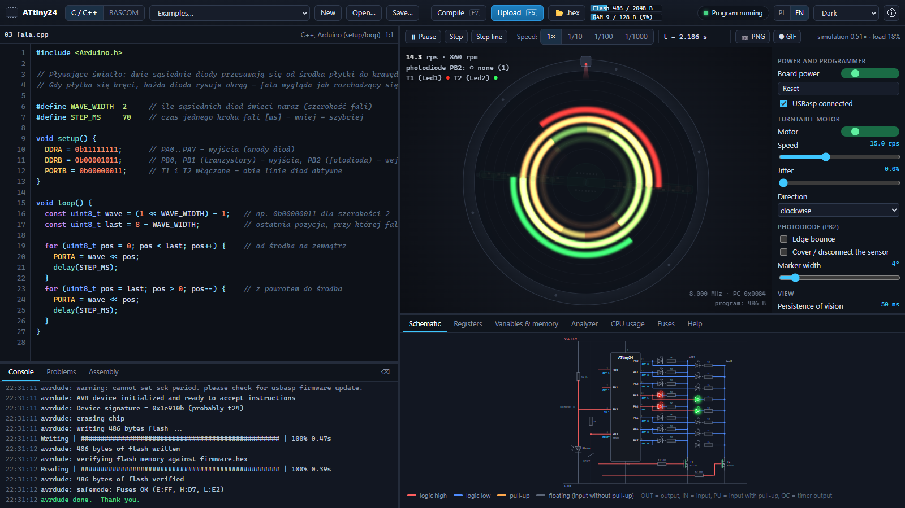
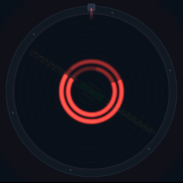
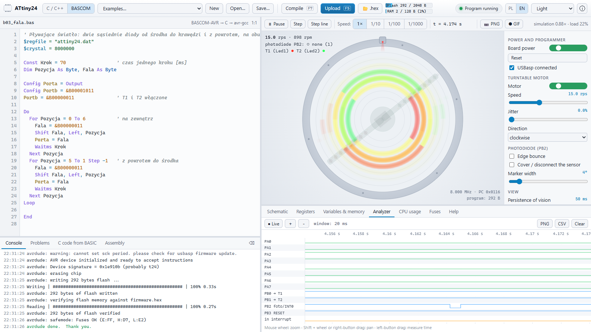
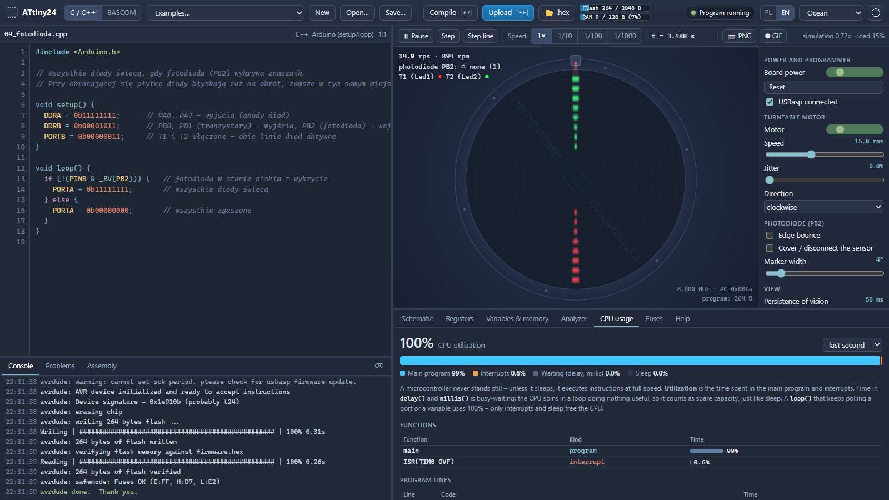
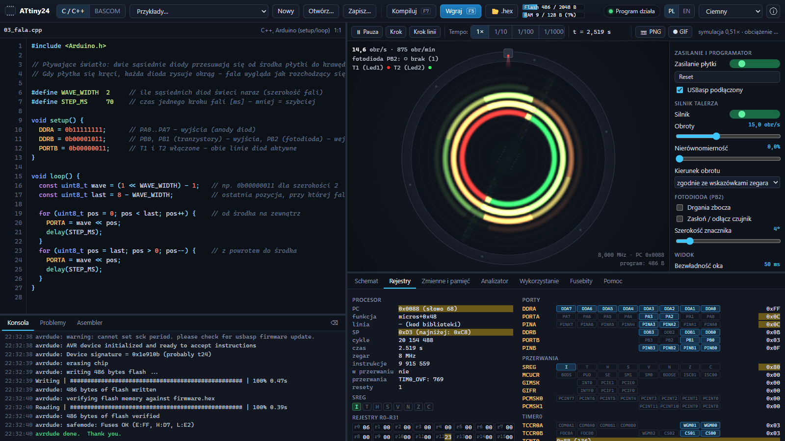

<h1 align="center">ATtiny24 POV Simulator</h1>

<p align="center">
  A cycle-accurate ATtiny24 emulator with a virtual spinning-LED (POV) lab board,<br>
  a real avr-gcc toolchain, a BASCOM-AVR translator and a debugger – in your browser.
</p>

<p align="center">
  <a href="https://kaniamateuszit.github.io/attiny24-pov-simulator/"><b>▶ Try it online</b></a>
  &nbsp;·&nbsp; <a href="#run-it-locally">Run it locally</a>
  &nbsp;·&nbsp; <a href="#features">Features</a>
  &nbsp;·&nbsp; <a href="#ready-hex-and-elf-files">Upload a .hex</a>
</p>

<p align="center">
  
</p>

---

## What is it

At the *Microprocessor Technology Lab* (Silesian University of Technology) we program a small rotating board:
an **ATtiny24** drives **16 LEDs on two arms**, a **photodiode** sees a marker once per revolution, and the image
appears only when the board spins (persistence of vision).

Lab time is short and the board is shared. This simulator lets you write, compile, upload and debug the same
programs anywhere – and see what the board would actually show, not just pin states.

<p align="center">
  
  <br><sub>Recorded with the simulator's own ⏺ GIF button</sub>
</p>

## Features

**Real compilation, byte-identical to the lab**
- Bundled **avr-gcc 7.3.0** and the **ATTinyCore** Arduino library – the same toolchain and flags PlatformIO uses
  (`board = attiny24`, `framework = arduino`), so the `.hex` is identical to the one flashed in the lab.
- **C / C++** with `Arduino.h` (`setup()` / `loop()`) or bare-metal with your own `main()`.
- **BASCOM-AVR**: a translator turns a practical subset of BASCOM into C (you can view the generated code).
- **Ready `.hex` / `.elf` files** from PlatformIO or the real BASCOM run without compiling – [details below](#ready-hex-and-elf-files).
- Simulated **USBasp + avrdude** upload, including realistic messages and errors (unplug the programmer and see).

**Cycle-accurate ATtiny24**
- Instruction-by-instruction emulation at 8 MHz with exact cycle counts.
- GPIO with pull-ups, **Timer0 / Timer1** (all modes, PWM, CTC), **INT0**, **PCINT**, **watchdog**, **EEPROM**,
  sleep modes, `CLKPR`, and **fuse bits** (wrong clock fuses really stop the clock).

**The lab board, modelled**
- 16 LEDs on two opposite arms (red branch via T1/PB0, green branch via T2/PB1), BS170 transistors,
  photodiode on PB2 (INT0).
- Motor with inertia, adjustable speed, jitter, direction and marker width.
- **POV rendering as the eye sees it** – rings, text and animations appear only when the timing is right.
- Live **schematic** with logic levels on every net.

**Debugging and insight**
- Pause, step by line (F10) or instruction (F11), breakpoints, registers with named bits, variables,
  RAM/stack map, EEPROM view, disassembly listing.
- **Logic analyzer** for all pins plus an "in interrupt" channel; drag to measure time and frequency.
- **CPU utilization**: how much time goes to the main program, interrupts, `delay()` busy-waiting and sleep –
  per function and per source line, counted from real cycles.
- **Diagnostics** for classic mistakes: missing ISR, stack overflowing into variables, watchdog reset loops,
  pull-up instead of output, wrong `F_CPU`, interrupts that take too long… with hints for compiler errors.

**Ready for lab reports**
- **📷 PNG** of the board view and **⏺ GIF** – a 4-second animation of the spinning board.
- Logic analyzer export: visible waveforms as **PNG**, state changes as **CSV**
  (semicolon and decimal comma in Polish mode, so Excel opens it directly).

**Your language, your colours**
- Interface in **English or Polish** – the PL / EN switch translates everything: help, console messages,
  diagnostics and compiler hints. The browser language is used on first start.
- Four **colour themes** – Dark, Light, Ocean and High contrast; the board view follows the theme.

<table>
  <tr>
    <td width="50%"></td>
    <td width="50%"></td>
  </tr>
  <tr>
    <td align="center"><sub>Light theme · BASCOM program · logic analyzer</sub></td>
    <td align="center"><sub>Ocean theme · CPU utilization per function and line</sub></td>
  </tr>
  <tr>
    <td colspan="2"></td>
  </tr>
  <tr>
    <td colspan="2" align="center"><sub>Polish interface · registers with named bits</sub></td>
  </tr>
</table>

## Run it locally

### Online – nothing to install

Open **https://kaniamateuszit.github.io/attiny24-pov-simulator/**. The examples run straight away (they come
precompiled) and you can upload your own **.hex / .elf** files. There is no compiler online – to write and compile
your own code, use one of the options below.

### Windows

Requirements: **Windows 10/11** and **Edge or Chrome**. The compiler is included.

1. Download the repository (**Code → Download ZIP**) and unpack it, or `git clone` it.
   Keep it in a path **without non-ASCII characters** (avr-gcc 7 does not handle them).
2. Double-click **`Symulator.bat`**.
3. The browser opens at `http://localhost:8024/` – on first start a demo is compiled, uploaded and the board starts spinning.

Closing the console window stops the simulator. If port 8024 is busy, the next free one (8024–8043) is used.

### Linux and macOS

Requirements: **Python 3**, a browser and **avr-gcc**. The Arduino library in `arduino/` was built with avr-gcc
**7.3.0**, so programs using `Arduino.h` need exactly that version – the easiest way is PlatformIO's toolchain:

```sh
pip install platformio
pio pkg install -g -t platformio/toolchain-atmelavr@1.70300.191015
./symulator.sh            # or: python3 serwer/serwer.py
```

The server looks for avr-gcc in `AVR_GCC_BIN`, then in PlatformIO's toolchain, then on `PATH`
(e.g. `apt install gcc-avr avr-libc` / `brew install avr-gcc`). With another gcc version, BASCOM programs and
C/C++ with your own `main()` still work; only Arduino-style programs may fail to link.

### Handy addresses

The address can preselect an example, the language and the theme:
`http://localhost:8024/#przyklad=03_fala.cpp&lang=en&theme=light`
(themes: `dark`, `light`, `ocean`, `contrast`).

## Ready .hex and .elf files

Click **📂 .hex** or drag files onto the window to run a program **without compiling** – locally and online.

| You upload | You get |
|---|---|
| `.hex` – from PlatformIO or the **real BASCOM** | the program runs 1:1 on the board, analyzer, registers, CPU usage, disassembly* |
| `.elf` – from PlatformIO | + function and variable names |
| `.elf` + `main.cpp` | + source view, line stepping, breakpoints, per-line CPU usage* |
| + `.eep` (optional) | EEPROM contents |

\* disassembly and line numbers come from avr-objdump, so they need the local version.

Because a `.hex` is machine code, programs from the real BASCOM compiler run exactly as on the board – no
translator involved. Fuse bits are not part of a `.hex`; the simulator assumes the lab settings (8 MHz, `E2 D7 FF`).

Where to find the files:
- **PlatformIO**: `.pio/build/<env>/firmware.hex` and `firmware.elf` (or the `build_dir` you configured).
- **BASCOM**: after *Compile*, a `.hex` with the program name appears next to the `.bas` file.

For line numbers from a PlatformIO `.elf`, add debug info at link time (the firmware itself does not change):

```ini
; platformio.ini
build_flags = -g
extra_scripts = debug_linii.py
```
```python
# debug_linii.py – with LTO, debug info is produced when linking
Import("env")
env.Append(LINKFLAGS=["-g"])
```

## Examples

The **Examples** menu contains the basic lab exercises, each in C++ and BASCOM:

| Example | What it shows |
|---|---|
| `01_miganie` | Blinking a single LED – port configuration, `delay` |
| `02_licznik` | Binary counter on 8 LEDs |
| `03_fala` | A light wave travelling from the centre to the edge – rings on the spinning board |
| `04_fotodioda` | Reading the photodiode: all LEDs flash once per revolution |

Your own programs are kept in the browser between sessions; **Open / Save** work with files on disk.

## Keyboard shortcuts

| Key | Action | Key | Action |
|---|---|---|---|
| F7 | Compile | F8 | Pause / resume |
| F5 | Compile and upload | F10 / F11 | Step line / instruction |
| Ctrl+S | Save the program | Ctrl+/ | Comment / uncomment |

## How it works

```
Symulator.bat ──► serwer/serwer.ps1   local HTTP server (Windows PowerShell 5.1)
symulator.sh  ──► serwer/serwer.py    the same server in Python (Linux, macOS, Windows)
                    ├─ serves aplikacja/        the web app
                    └─ runs  avr-gcc, nm, objdump  ──► hex, symbols, line table, listing

aplikacja/js/
  avr.js            ATtiny24 core and peripherals, cycle-accurate
  stanowisko.js     the lab board: motor, photodiode, LEDs, POV light accumulation
  widok.js          board rendering              schemat.js        live schematic
  bascom.js         BASCOM → C translator        kompilacja.js     build results (hex, symbols, lines)
  analizator.js     logic analyzer               wykorzystanie.js  CPU utilization profiler
  plik.js           .hex / .elf loading          eksport.js        PNG / GIF / CSV export
  i18n.js, en.js    PL / EN switch, dictionary   main.js           UI: editor, upload, debugger, panels
```

Everything runs in the browser; the server only runs the real compiler. The online version
(GitHub Pages, `.github/workflows/pages.yml`) is the same `aplikacja/` folder: instead of compiling, the examples
use build results stored in `aplikacja/przyklady/build/`. After changing an example, start the simulator and run
`node tools/zbuduj-przyklady.mjs` to refresh them.

## Limitations

- ADC, analog comparator, USI and Timer1 input capture are simplified (the lab board does not use them).
- BASCOM source: a subset of the language (listed in the **Help** tab); no `String` or `Print`;
  `Sub` / `Function` parameters are passed by value unless declared `Byref`.
  A `.hex` from the real BASCOM has no such limits.
- The bundled compiler is for Windows; on Linux/macOS you install avr-gcc yourself.
- Comments in the bundled example programs are in Polish.

## Author

Created by **Mateusz Kania** for the Microprocessor Technology Lab at the Silesian University of Technology.

## License

The simulator source code is released under the [MIT License](LICENSE).
The bundled toolchain and Arduino core keep their own licenses – see [THIRD_PARTY_NOTICES.md](THIRD_PARTY_NOTICES.md).
